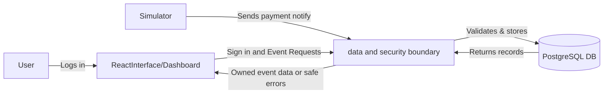

# BRIEF : MerchantDesk

## 1.User

The **Merchant support operators** who checks the payment events.

## 2.Useful Actions

- **Browse and inspect payments** to quickly see whether a transaction was successfully captured or failed.
- **Identify duplicate evnents** by checking providers provider_event_id and timestamps(occured_at) to resolve customer support events.
- **Inspect one own event** to understand more details of that event.

## 3.Non Goals

- **No real money or payments.**
- **No sass level dashboard.**
- **No real refund execution**
- **No real finacial data**

## 4.Open Questions

1. Should support operators be able to search events by providers email address or only by provider_event_id and occured_at?
2. Do failed and duplicate events should have a different visual styling in the UI?
3. How many **payment events** should show up on a single page on the dashboard?
4. Should an operator's login session expire automatically after 1 hour of inactivity?
5. How long we need to keep the test payment inside the Databse?

## 5. Successful Demo

- **Secure Sign-in:** Successfully logs in as a seeded synthetic merchant operator.
- **Event Ingestion:** Submits and records a test payment event through the sandbox API/simulator.
- **Dashboard Filtering:** filters through the payment events cleanly.
- **Event Inspection:** Selects and inspects an individual owned event to review its full details.
- **Clean Sign-out:** Successfully signs out and terminates the session.

## Diagram

