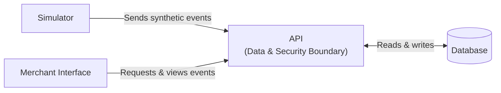

# MerchantDesk brief

MerchantDesk is an application that records synthetic payment events and lets a merchant operator inspect them.

## User and Need

The user is a merchant operator who receives synthetic payment events from a payment simulator. They need a single place to inspect these events so they can clearly see which payments were captured, which failed, whether an event was sent more than once, and which records belong to their merchant.

## Useful Actions in V1

- Submit a payment event through the MerchantDesk API.
- View, filter, and paginate that merchant's events.
- Inspect a payment event they own.

## Non Goals

- Real payment processing.
- Provider credentials.
- Account registration.
- Refund execution.
- Customer data
- HMAC verification.
- Exposed webhook endpoints.
- Polished commercial dashboard.

## Open Questions

1. What should happen when the same event is submitted more than once?
2. Which event details should the operator be able to filter by?
3. How should the operator know the events belong to their merchant?
4. Should event deletion be allowed for operators?
5. What information would help the operator understand why an event failed?

## Successful Demo

- The operator signs in with a seeded synthetic merchant account.
- The operator views and filters their merchant's events, then inspects one event.
- The demo shows accepted, rejected, and duplicate event outcomes.
- The operator can see only records belonging to their merchant.

## Context Diagram

